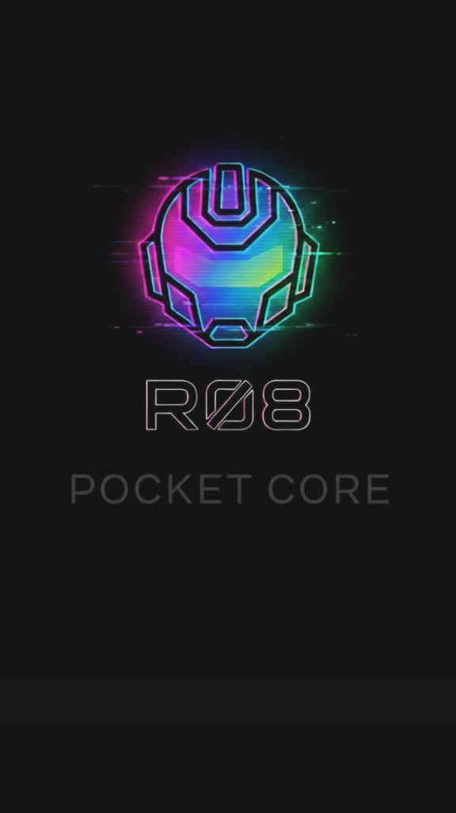

<p align="center">
  
</p>

# 🇮🇹 gpTommy 32k — Vocabolario & Tokenizer Nativo per la Lingua Italiana

[](https://www.sentinelhub.eu)
[](https://www.sentinelhub.eu)
[](https://github.com/Thomasseri/gpTommy-32k)
[](https://github.com/Thomasseri/gpTommy-32k)
[-orange.svg)](https://www.sentinelhub.eu)

> **Vocabolario e Tokenizer lessicale a 32.768 token concepito e strutturato specificamente per la lingua italiana.**  
> **Autore & Ideatore:** Thomas Seri (Sentinel)  
> **Ecosistema di Riferimento:** [Sentinel LifeOS](https://www.sentinelhub.eu) & Famiglia di Modelli **Sentinel R-08**

---

> ### 💼 Investment, Compute Grants & Enterprise Licensing (Investimenti & Partnership Industriali)
> 🇬🇧 **Sentinel** is scaling the **Geodesic Pyramidal Sphere Architecture (`R-08`)** from 50M to **110M–1B+ parameters**, with **patent applications filed at the Italian Patent and Trademark Office (UIBM)**.  
> **Open to Seed / Deep-Tech Investment, GPU/TPU Compute Grants, and Enterprise R&D Partnerships.**  
> 🇮🇹 **Aperto a Investimenti Seed / Deep-Tech, Grant Computazionali GPU/TPU e Licenze Industriali Enterprise.**  
> 📩 **Contact Founder & Inventor Thomas Seri:** 🌐 **[www.sentinelhub.eu](https://www.sentinelhub.eu)** | 🐙 **[GitHub (@Thomasseri)](https://github.com/Thomasseri)** | 🤗 **[Hugging Face (@SentinelHub)](https://huggingface.co/SentinelHub)** | 💬 **[Open an Inquiry / Issue](https://github.com/Thomasseri/R-08/issues/new)**

---

## 🌐 Ecosistema Sentinel & Modelli R-08 Correlati

Il vocabolario **gpTommy 32k** è il motore lessicale ad alta densità impiegato per la nuova generazione di modelli geodetici compatti e leggeri della famiglia **Sentinel R-08**:

* 🌍 **Sito Ufficiale:** **[www.sentinelhub.eu](https://www.sentinelhub.eu)** — Piattaforma Sentinel LifeOS
* 🤖 **Sentinel R-08 v7 (Pyramid 44.5M):** [GitHub](https://github.com/Thomasseri/R-08) | [Hugging Face](https://huggingface.co/SentinelHub/R-08)
* 🚀 **Sentinel R-08 v7.2 (51.6M con 12 Hub Icosaedrici):** [GitHub](https://github.com/Thomasseri/R-08-v7.2) | [Hugging Face](https://huggingface.co/SentinelHub/R-08-v7.2)
* 🌟 **Sentinel R-08 v7.2a DA ZERO (51.6M 82.51% BLiMP-IT, migliore tra gli R-08):** [GitHub](https://github.com/Thomasseri/R-08-v7.2a) | [Hugging Face](https://huggingface.co/SentinelHub/R-08-v7.2a)
* 🔬 **Modello di Controllo A/B Transformer Baseline (44.9M):** [GitHub](https://github.com/Thomasseri/R-08-Transformer-Baseline) | [Hugging Face](https://huggingface.co/SentinelHub/R-08-Transformer-Baseline)

### 🌍 Suite Europea Multilingua gpTommy 32k (32.768 Token Nativi per Lingua):
* 🇮🇹 **Italiano (`gpTommy-32k`):** [GitHub](https://github.com/Thomasseri/gpTommy-32k) | [Hugging Face](https://huggingface.co/SentinelHub/gpTommy-32k)
* 🇬🇧 **English (`gpTommy-32k-EN`):** [GitHub](https://github.com/Thomasseri/gpTommy-32k-EN) | [Hugging Face](https://huggingface.co/SentinelHub/gpTommy-32k-EN)
* 🇩🇪 **Deutsch (`gpTommy-32k-DE`):** [GitHub](https://github.com/Thomasseri/gpTommy-32k-DE) | [Hugging Face](https://huggingface.co/SentinelHub/gpTommy-32k-DE)
* 🇫🇷 **Français (`gpTommy-32k-FR`):** [GitHub](https://github.com/Thomasseri/gpTommy-32k-FR) | [Hugging Face](https://huggingface.co/SentinelHub/gpTommy-32k-FR)
* 🇪🇸 **Español (`gpTommy-32k-ES`):** [GitHub](https://github.com/Thomasseri/gpTommy-32k-ES) | [Hugging Face](https://huggingface.co/SentinelHub/gpTommy-32k-ES)

---

## 🎯 Perché gpTommy 32k è Diverso dai Tokenizer Tradizionali

I tokenizer BPE statistici tradizionali calibrati prevalentemente sulla lingua inglese presentano una forte frammentazione quando applicati alla morfologia italiana. Nel testo italiano questo comporta una grave frammentazione:
* Una parola come *«cuscinetto»* o *«manutenzione»* viene spezzata in 3 o 4 sottosillabe arbitrarie (`cus-`, `ci-`, `net-`, `to`), aumentando a dismisura la lunghezza del contesto, i costi computazionali e il rischio di allucinazioni ortografiche.

**gpTommy 32k** adotta un approccio lessicale nativo e strutturato:
* Contiene **29.775 parole italiane complete** (il **90,9%** dell'intero vocabolario), coprendo forme base, singolari, plurali, verbi coniugati e l'intero lessico tecnico-scientifico.
* Le parole non vengono spezzettate: la rete neurale associa un **singolo token atomico** a ciascun concetto lessicale finito.

---

## 📐 Metriche Oggettive di Compressione & Nota sulla Nomenclatura (`32k`)

* **Significato di `32k`**: Il suffisso **`32k`** indica la **dimensione del vocabolario lessicale (`32.768` token ID distinti)** e non la finestra di contesto del modello.
* **Efficienza di Tokenizzazione (Fertilità Lessicale sull'Italiano Tecnico)**:
  Su testo tecnico e industriale italiano (es. *«Il cuscinetto a sfere radiale riduce l'attrito volvente nella manutenzione dei cilindri pneumatici»*), **gpTommy 32k** mantiene un rapporto medio di **`~1,06 token per parola lessicale`** (1 singolo token atomico per ciascun sostantivo, aggettivo o verbo presente nelle 29.775 voci), contro i **`2,4 – 3,2 sub-token per parola`** tipici dei tokenizer statistici subword non nativi.

---

## 📚 Architettura ad Archivio: Il Sistema a Schede `SSvvv`

Il vocabolario gpTommy adotta una codifica deterministica a 5 cifre `SSvvv`:
* **`SS` (Scheda)**: Indica la categoria o la lettera dell'alfabeto (da `01` a `26` per le lettere **A..Z**).
* **`vvv` (Riga)**: Indica la specifica riga / lemma all'interno di quella scheda.

| Scheda | Intervallo ID | Contenuto Principale | Esempi di Token |
| :---: | :---: | :--- | :--- |
| **`00`** | `00000` – `00999` | Token speciali AI, punteggiatura, cifre, simboli matematici | `<\|user\|>`, `<\|assistant\|>`, `<\|system\|>`, `+`, `-`, `=`, `*`, `%` |
| **`01`** | `01000` – `01999` | Lettera **A** (parole italiane e forme latine) | `anche`, `amico`, `allora`, `avere`, `analizzare`, `attualità` |
| **`03`** | `03000` – `03999` | Lettera **C** | `casa`, `cosa`, `città`, `cuscinetto`, `costruire`, `cilindro` |
| **`07`** | `07000` – `07999` | Lettera **G** | `giorno`, `grande`, `gruppo`, `giovane`, `governo` |
| **`20`** | `20000` – `20999` | Lettera **T** | `tempo`, `terra`, `tavolo`, `totale`, `tiranti`, `trasmissione` |
| **`26`** | `26000` – `26999` | Lettera **Z** (oltre 940 lemmi in Z) | `zona`, `zone`, `zero`, `zio`, `zucchero`, `zaino`, `zitto`, `zucca` |

---

## 📊 Ripartizione dei 32.768 Token

```
┌─────────────────────────────────────────────────────────────┐
│                   gpTommy 32k (32.768 ID)                   │
├──────────────────────────────────────┬──────────┬───────────┤
│ Tipologia                            │ Conteggio│ Percentual│
├──────────────────────────────────────┼──────────┼───────────┤
│ Parole Italiane Complete             │   29.775 │     90,9% │
│ Caratteri Singoli, Cifre e Simboli   │    1.925 │      5,9% │
│ Token Speciali di Controllo & Chat   │    1.069 │      3,2% │
└──────────────────────────────────────┴──────────┴───────────┘
```

---

## 🚀 Utilizzo Rapido in Python (Zero Dipendenze Esterne)

Il tokenizer `gptommy_tokenizer.py` è completamente autonomo e non richiede pacchetti pesanti esterni:

```python
from gptommy_tokenizer import gpTommyTokenizer

# 1. Inizializza il tokenizer con il vocabolario gpTommy
tokenizer = gpTommyTokenizer()

# 2. Codifica una frase italiana in token ID
testo = "Il cuscinetto a sfere radiale riduce l'attrito volvente."
token_ids = tokenizer.encode(testo)
print("Token IDs:", token_ids)
# Esempio: [9043, 10, 3001, 21472, 14147, 10, 1001, 10, 19529, ...]

# 3. Decodifica tornando al testo italiano originale
testo_ricostruito = tokenizer.decode(token_ids)
print("Decodifica:", testo_ricostruito)
# Output: "Il cuscinetto a sfere radiale riduce l'attrito volvente."
```

---

## 🛡️ Licenza e Attribuzione
Questo vocabolario è rilasciato per scopi di **Ricerca Scientifica e Sperimentazione Libera (Non-Commercial Research License)** con vincoli etici di protezione (esclusione di impieghi bellici, propaganda e usi lesivi). 

Tutti i diritti sull'architettura a schede e sull'organizzazione lessicale sono riservati a **Thomas Seri (Sentinel)**. Per collaborazioni o utilizzi in progetti di produzione: **[www.sentinelhub.eu](https://www.sentinelhub.eu)**.
